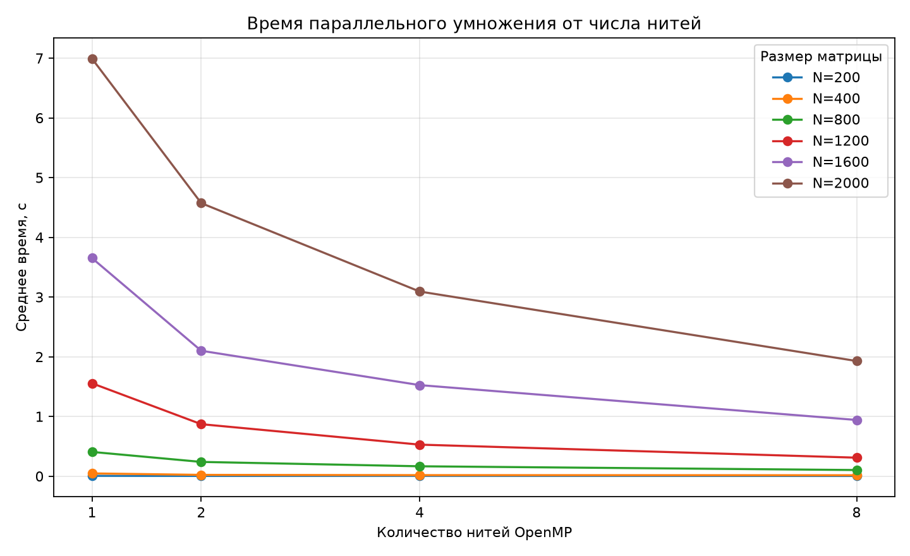
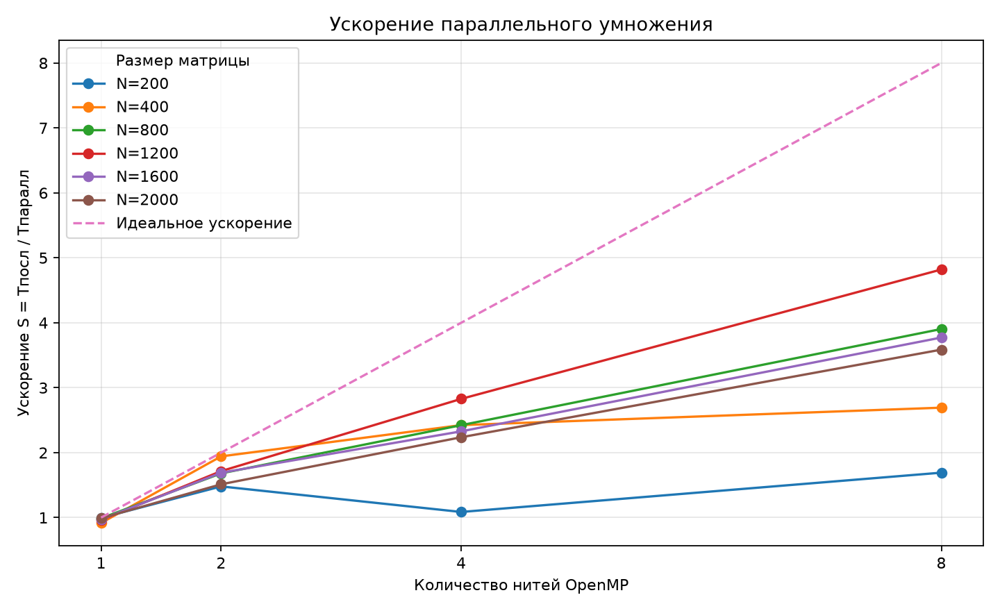
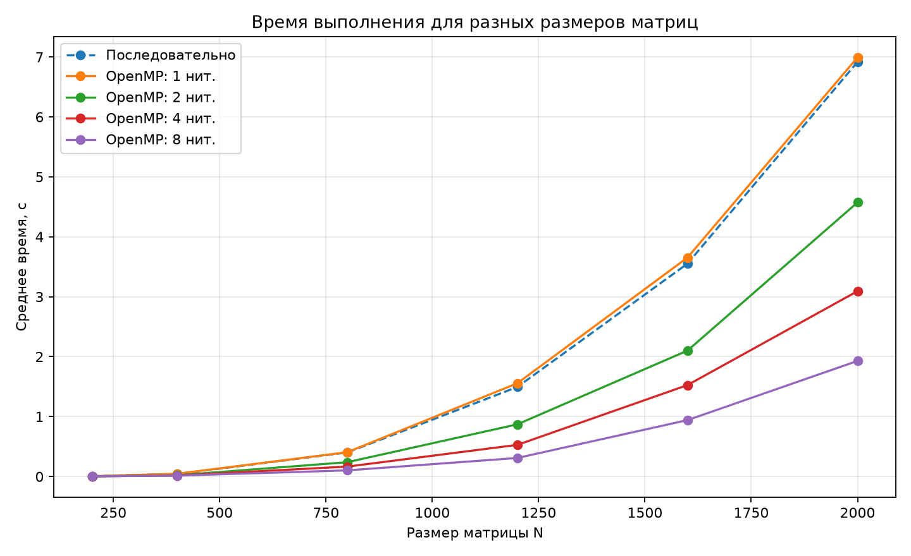

# Лабораторная работа №2 — параллельное умножение матриц с OpenMP

## Цель работы
Модифицировать программу последовательного умножения квадратных матриц с использованием технологии OpenMP, исследовать влияние размера матрицы и количества нитей на время вычислений.

## Реализация
В программе оставлены два варианта одного алгоритма: последовательный (`multiply_sequential`) и параллельный (`multiply_parallel`). Параллельный вариант использует директиву `#pragma omp parallel for` для распределения строк результирующей матрицы между нитями.

Каждая нить вычисляет отдельные строки матрицы C. Поэтому разные нити записывают в разные элементы результата, и синхронизация при накоплении суммы не требуется. Для обеих реализаций используется одинаковый порядок циклов `i-k-j`: он обеспечивает последовательный доступ к элементам строк матриц B и C.

Исходные матрицы хранятся в `A.txt` и `B.txt`; результат записывается в `result.txt`. Файлы имеют формат: размер N в первой строке, далее N строк по N чисел.

## Запуск на Windows (Visual Studio Community)

Откройте **x64 Native Tools Command Prompt for VS** или **x64 Native Tools PowerShell for VS**, перейдите в папку `Lab2` и выполните команды:

```cmd
cl /EHsc /O2 /openmp /std:c++17 main.cpp /Fe:matrix.exe
py -m pip install -r requirements.txt
py experiment.py --exe .\matrix.exe
```

Скрипт автоматически проверяет доступное количество логических процессоров и по умолчанию использует уровни 1, 2, 4 и 8 нитей, если они доступны. Если максимальный уровень из этого набора недоступен, добавляется доступное количество процессоров (например, 6). Для явного задания уровней можно использовать `--threads 1 2 4 8`.

Вместо ручного ввода команд можно запустить `run_experiments.bat` из x64-среды Visual Studio.

## Запуск на Linux

```bash
g++ -std=c++17 -O2 -fopenmp main.cpp -o matrix
python3 -m pip install -r requirements.txt
python3 experiment.py --exe ./matrix
```

## Ручной запуск отдельных вариантов

```cmd
py generate.py 800
matrix.exe --mode sequential --threads 1
matrix.exe --mode parallel --threads 4
py check.py
```

Режим `sequential` выполняет последовательное умножение. Режим `parallel` использует указанное число нитей OpenMP. Время в выводе программы измеряет только операцию умножения, без чтения исходных файлов и записи результата.

## Методика эксперимента

Для размеров матриц 200, 400, 800, 1200, 1600 и 2000 сравниваются последовательный вариант и параллельный вариант с разным количеством нитей. Для каждой конфигурации выполняется три повтора; в таблицу заносится среднее время. После последнего повтора каждой конфигурации результат проверяется независимым вычислением NumPy.

Скрипт `experiment.py` сохраняет промежуточные данные после каждой конфигурации, поэтому уже полученные результаты не теряются, если последующий запуск будет прерван. Он формирует `results/results.csv`, три графика и обновляет таблицу в этом README. Количество повторов и размеры можно переопределить параметрами `--repeats` и `--sizes`.

## Результаты экспериментов
<!-- RESULTS_START -->

**Условия измерений:** Windows-10-10.0.26200-SP0; процессор: Intel64 Family 6 Model 165 Stepping 3, GenuineIntel; логических CPU: 8; Python 3.11.5. Размеры: 200, 400, 800, 1200, 1600, 2000; количество нитей OpenMP: 1, 2, 4, 8; повторов на конфигурацию: 3. Время измерено внутри C++-программы только для умножения матриц, без чтения и записи файлов. Компиляция выполнялась отдельно.

### Таблица результатов экспериментов

Последовательный вариант используется как базовый. Ускорение рассчитано по формуле S = Tпосл / Tпаралл; эффективность — E = S / p × 100%, где p — число нитей OpenMP. Проверка PASS означает совпадение результата с независимым вычислением NumPy.

| N | Режим | Нити | Среднее время, с | Мин. время, с | Ускорение | Эффективность, % | Проверка |
|---:|:---|---:|---:|---:|---:|---:|:---:|
| 200 | Последовательно | 1 | 0.005652 | 0.005624 | 1.000 | — | PASS |
| 200 | OpenMP | 1 | 0.005679 | 0.005613 | 0.995 | 99.5 | PASS |
| 200 | OpenMP | 2 | 0.003819 | 0.003374 | 1.480 | 74.0 | PASS |
| 200 | OpenMP | 4 | 0.005202 | 0.002318 | 1.086 | 27.2 | PASS |
| 200 | OpenMP | 8 | 0.003342 | 0.003137 | 1.692 | 21.1 | PASS |
| 400 | Последовательно | 1 | 0.042715 | 0.042521 | 1.000 | — | PASS |
| 400 | OpenMP | 1 | 0.046611 | 0.042253 | 0.916 | 91.6 | PASS |
| 400 | OpenMP | 2 | 0.021989 | 0.021959 | 1.943 | 97.1 | PASS |
| 400 | OpenMP | 4 | 0.017621 | 0.016042 | 2.424 | 60.6 | PASS |
| 400 | OpenMP | 8 | 0.015865 | 0.012229 | 2.692 | 33.7 | PASS |
| 800 | Последовательно | 1 | 0.401979 | 0.388579 | 1.000 | — | PASS |
| 800 | OpenMP | 1 | 0.406552 | 0.371711 | 0.989 | 98.9 | PASS |
| 800 | OpenMP | 2 | 0.239157 | 0.192042 | 1.681 | 84.0 | PASS |
| 800 | OpenMP | 4 | 0.165918 | 0.154280 | 2.423 | 60.6 | PASS |
| 800 | OpenMP | 8 | 0.102979 | 0.087451 | 3.904 | 48.8 | PASS |
| 1200 | Последовательно | 1 | 1.494304 | 1.492726 | 1.000 | — | PASS |
| 1200 | OpenMP | 1 | 1.555930 | 1.486885 | 0.960 | 96.0 | PASS |
| 1200 | OpenMP | 2 | 0.871111 | 0.768849 | 1.715 | 85.8 | PASS |
| 1200 | OpenMP | 4 | 0.528449 | 0.442444 | 2.828 | 70.7 | PASS |
| 1200 | OpenMP | 8 | 0.310021 | 0.303481 | 4.820 | 60.3 | PASS |
| 1600 | Последовательно | 1 | 3.550756 | 3.354384 | 1.000 | — | PASS |
| 1600 | OpenMP | 1 | 3.652336 | 3.630311 | 0.972 | 97.2 | PASS |
| 1600 | OpenMP | 2 | 2.100479 | 1.908292 | 1.690 | 84.5 | PASS |
| 1600 | OpenMP | 4 | 1.525317 | 1.446900 | 2.328 | 58.2 | PASS |
| 1600 | OpenMP | 8 | 0.941282 | 0.740251 | 3.772 | 47.2 | PASS |
| 2000 | Последовательно | 1 | 6.916947 | 6.777300 | 1.000 | — | PASS |
| 2000 | OpenMP | 1 | 6.992777 | 6.645277 | 0.989 | 98.9 | PASS |
| 2000 | OpenMP | 2 | 4.572703 | 4.338647 | 1.513 | 75.6 | PASS |
| 2000 | OpenMP | 4 | 3.092279 | 2.980510 | 2.237 | 55.9 | PASS |
| 2000 | OpenMP | 8 | 1.928842 | 1.888713 | 3.586 | 44.8 | PASS |

### Графики

**Время параллельного умножения в зависимости от числа нитей:**



**Ускорение относительно последовательной реализации:**



**Время выполнения для разных размеров матриц:**



**Вывод:** ускорение и эффективность зависят от размера матрицы и числа нитей. При небольших размерах накладные расходы на создание и координацию нитей могут уменьшать выигрыш. Для крупных матриц параллельная обработка может сократить время вычислений; фактический результат определяется характеристиками процессора и измерениями на данном компьютере.

<!-- RESULTS_END -->

## Выводы

В ходе лабораторной работы была реализована параллельная версия
умножения квадратных матриц с использованием технологии OpenMP.

Проведены эксперименты для матриц размером от 200 × 200
до 2000 × 2000 с использованием 1, 2, 4 и 8 потоков.

Результаты показали, что эффективность параллельных вычислений
зависит от размера матрицы и количества потоков.

Максимальное ускорение составило 4,82 раза для матрицы
1200 × 1200 при использовании 8 потоков.
Для матрицы 2000 × 2000 ускорение составило 3,59 раза.

При небольших размерах матриц выигрыш от распараллеливания
меньше из-за дополнительных расходов на организацию
параллельных вычислений.

Все результаты вычислений успешно прошли проверку
с использованием NumPy.

Таким образом, применение OpenMP позволяет существенно
сократить время умножения больших матриц, однако
эффективность распараллеливания зависит от размера задачи
и количества используемых потоков.